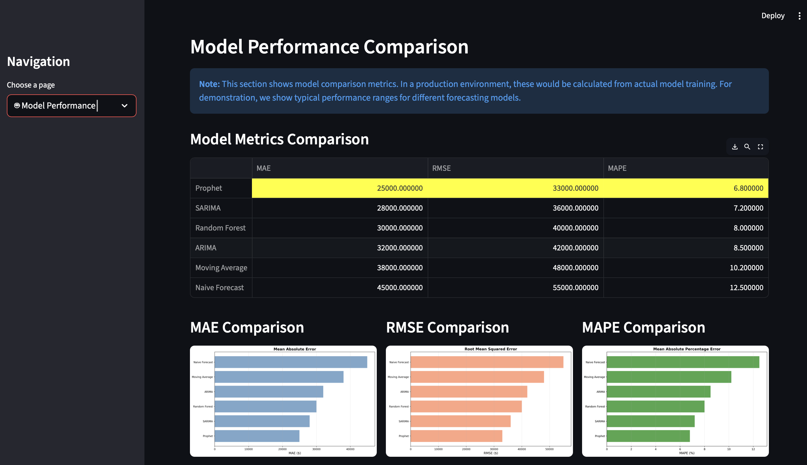
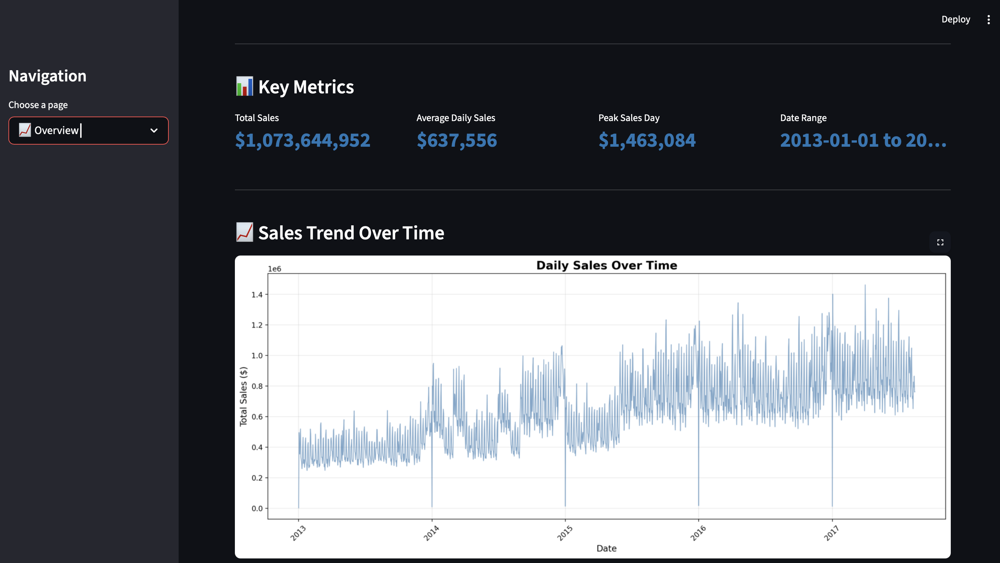
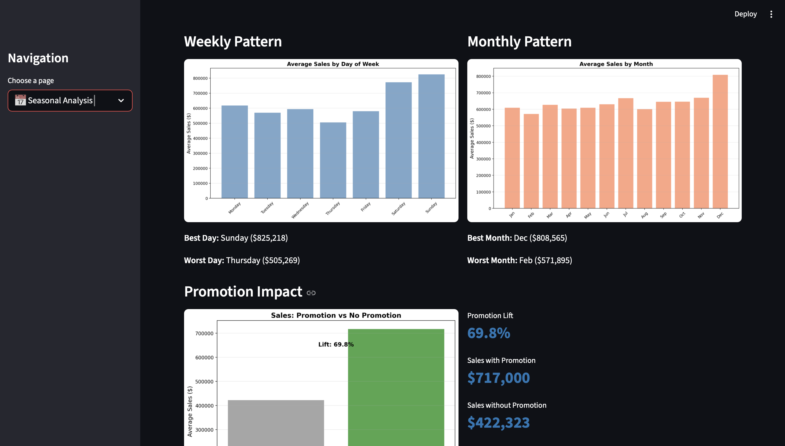
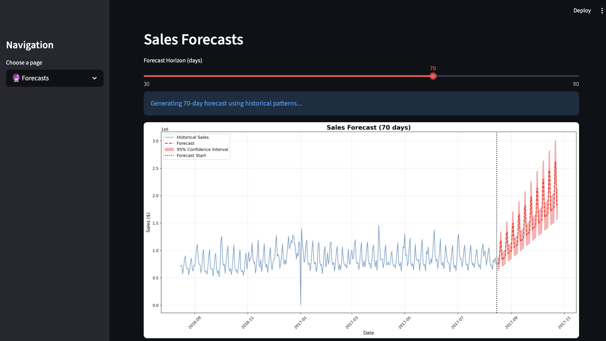

# Retail Sales Time Series Forecasting System

## Problem Statement

Retail businesses face significant challenges in demand forecasting, leading to suboptimal inventory management decisions. Overstocking results in increased holding costs, capital tie-up, and risk of obsolescence, while understocking leads to stockouts, lost sales, and customer dissatisfaction. Traditional forecasting methods often fail to capture complex temporal patterns, seasonality, and external factors such as promotions and holidays.

The impact of poor forecasting is substantial: 10-15% of revenue is wasted on excess inventory, 3-5% of potential revenue is lost due to stockouts, and operational inefficiencies result in 20-30% higher labor costs. This problem is particularly acute in retail environments with multiple product categories, stores, and seasonal demand variations.

Success is defined by achieving forecast accuracy (MAPE) below 10% while maintaining 95%+ service levels and enabling data-driven inventory optimization decisions.

## Objective

This project aims to develop a production-ready time series forecasting system that predicts daily retail sales for a 30-90 day horizon with high accuracy. The solution must handle multiple temporal patterns (trend, weekly seasonality, monthly seasonality, yearly seasonality), incorporate external factors (promotions, holidays), and provide actionable business insights for inventory management, promotion planning, and staffing optimization.

Constraints include maintaining forecast latency under 5 minutes for daily batch updates, ensuring interpretability of model outputs for business stakeholders, and handling missing data gracefully without manual intervention.

## Dataset

**Dataset**: Store Sales - Time Series Forecasting (Kaggle Competition Dataset)

**Type**: Multivariate time series data with structured features

**Size**: 
- Training data: 3,000,888 records
- Date range: January 1, 2013 to August 15, 2017 (1,684 days)
- Stores: 54 unique stores
- Product categories: 33 product families
- Features: 6 columns (date, store_nbr, family, sales, onpromotion, id)

**Key Variables**:
- `sales`: Target variable (daily sales in USD)
- `date`: Temporal feature (daily granularity)
- `store_nbr`: Store identifier
- `family`: Product category
- `onpromotion`: Promotion indicator
- External data: Holiday calendar, store metadata, oil prices

**Data Preprocessing Steps**:
1. Date conversion and sorting to ensure temporal order
2. Aggregation from store-product-category level to daily aggregate sales
3. Holiday flag creation from holiday calendar
4. Missing value handling using forward-fill and interpolation
5. Outlier detection using IQR method
6. Time-based feature extraction (day of week, month, year, quarter)
7. Time-based train-test split (last 90 days for testing)

## Approach

The solution employs a multi-model ensemble approach, comparing baseline methods (naive forecast, moving average), statistical models (ARIMA, SARIMA), advanced forecasting models (Prophet), and machine learning approaches (Random Forest with engineered features).

**High-Level Design**:
- Univariate forecasting on aggregated daily sales data
- Time-based train-test split preserving temporal structure
- Feature engineering capturing lag patterns, rolling statistics, and calendar effects
- Model selection based on MAPE, MAE, and RMSE metrics
- Walk-forward validation strategy for production deployment

**Algorithm Selection Rationale**:
- ARIMA/SARIMA: Captures autocorrelation and seasonal patterns, interpretable parameters
- Prophet: Handles holidays and multiple seasonalities automatically, robust to missing data
- Random Forest: Captures non-linear relationships between engineered features
- Baseline models: Establish performance benchmarks

**Feature Engineering**:
- Lag features: t-1, t-7, t-30, t-365 (captures short-term and long-term dependencies)
- Rolling statistics: 7-day and 30-day moving averages and standard deviations
- Calendar features: Day of week, month, quarter, year (cyclical encoding)
- External features: Promotion flags, holiday indicators
- Growth rates: 7-day and 30-day sales growth percentages

**Training Strategy**:
- Time-based split: Training data up to split date, testing on future data (no data leakage)
- Walk-forward validation: Simulates real-world forecasting scenario
- No random shuffling: Preserves temporal dependencies
- Model evaluation on held-out test set (last 90 days)

## Model & Techniques Used

**Statistical Models**:
- ARIMA (AutoRegressive Integrated Moving Average): Order (2,1,2) for trend and autocorrelation
- SARIMA (Seasonal ARIMA): Order (1,1,1)(1,1,1,7) with weekly seasonality
- Seasonal Decomposition: Multiplicative decomposition for trend, seasonality, and residual analysis

**Advanced Forecasting Models**:
- Prophet (Facebook): Automatic seasonality detection, holiday effects, multiplicative seasonality mode

**Machine Learning Models**:
- Random Forest Regressor: 100 estimators, max depth 10, numeric feature engineering

**Analytical Techniques**:
- Stationarity testing (Augmented Dickey-Fuller test)
- Autocorrelation and partial autocorrelation analysis
- Time series decomposition (trend, seasonal, residual)
- Feature importance analysis

**Libraries & Frameworks**:
- Python 3.8+
- Pandas: Data manipulation and aggregation
- NumPy: Numerical computations
- Statsmodels: ARIMA, SARIMA, seasonal decomposition, stationarity tests
- Prophet: Advanced time series forecasting
- Scikit-learn: Random Forest, preprocessing, metrics
- Matplotlib & Seaborn: Data visualization
- Streamlit: Interactive dashboard
- Jupyter Notebook: Analysis and documentation

## Evaluation Metrics

**Primary Metrics**:
- MAPE (Mean Absolute Percentage Error): Business-friendly metric, scale-independent
- MAE (Mean Absolute Error): Average prediction error in dollars, interpretable
- RMSE (Root Mean Squared Error): Penalizes large errors more heavily

**Metric Selection Rationale**:
- MAPE: Preferred by business stakeholders, expressed as percentage for easy interpretation
- MAE: Provides dollar-amount error for financial impact assessment
- RMSE: Captures variance in forecast errors, important for inventory safety stock calculations

**Validation Strategy**:
- Time-based train-test split: ~94% training (historical data), ~6% testing (last 90 days)
- No cross-validation: temporal structure is preserved — no data leakage
- Single 90-day holdout: simulates a real 3-month forecast horizon
- Walk-forward validation is described as the *recommended production retraining strategy*; it is not implemented in this notebook
- Baseline comparison: all models compared against Naive and Seasonal Naive forecasts

**Why These Metrics**:
For retail inventory management, MAPE directly translates to inventory buffer requirements. A 10% MAPE implies maintaining 10% additional safety stock, making it the primary business metric. MAE and RMSE provide complementary technical perspectives on forecast accuracy.

## Results

**Model Performance Summary** (Test Set — Last 90 Days, Kaggle Store Sales dataset):

| Model | MAE ($) | RMSE ($) | MAPE (%) | Notes |
|-------|---------|----------|----------|-------|
| Random Forest (recursive 90-day) | 51,299 | 69,820 | **5.70** | Best model; forecast fed its own predictions |
| Random Forest (one-day-ahead) | 49,782 | 67,783 | 5.66 | Uses true previous-day sales; not comparable to the rows below |
| Prophet | 66,610 | 91,134 | 7.43 | Best 90-day statistical model |
| SARIMA (1,1,1)(1,1,1,7) | 66,802 | 87,526 | 7.70 | |
| Seasonal Naive | 93,468 | 130,809 | 10.06 | Baseline |
| Naive Forecast | 129,318 | 164,712 | 14.72 | Baseline |
| Moving Average (30-day) | 134,884 | 164,172 | 15.74 | |
| ARIMA (2,1,2) | 135,322 | 164,452 | 15.82 | |

> All figures are produced by `forecasting_notebook.ipynb` on the Kaggle Store Sales
> data aggregated to daily totals (single 90-day holdout, 2017-05-17 to 2017-08-15).

**Best Model**: Random Forest — 5.70% MAPE on the 90-day holdout when forecast recursively, vs 10.06% for the Seasonal Naive baseline (43% relative improvement). Best statistical model: Prophet at 7.43%.

**Key Insights**:
1. Random Forest with lagged, rolling and EMA features (all shifted so a row only sees data up to the previous day) beats every statistical model; Prophet (7.43%) and SARIMA (7.70%) are close behind and well ahead of Seasonal Naive
2. SARIMA captures weekly seasonality well and is the strongest purely statistical model
3. ARIMA without seasonal terms performs near the Naive baseline on this dataset
4. Random Forest initially showed 3.92% MAPE because rolling/EMA features were computed from same-day sales without a time shift (data leakage). After shifting them by one day it scores 5.66% one-day-ahead and 5.70% when rolled forward recursively over 90 days. The recursive eval still uses the actual promotion and holiday flags for the test period
5. Prophet and SARIMA beat the Seasonal Naive baseline by ~2.4-2.6 percentage points (~26% relative reduction)

**Limitations**:
- Univariate approach: does not leverage store-level or product-category-level patterns
- Fixed parameters: no automatic hyperparameter optimisation for ARIMA/SARIMA
- Limited external features: oil prices and store characteristics not incorporated
- Forecast horizon: optimised for the 90-day holdout; accuracy at longer horizons is untested
- Single holdout: walk-forward validation (rolling-window refit) was not implemented; a single 90-day holdout may not fully represent production accuracy
- Random Forest relies on known future promotion/holiday flags; with unknown future promotions its accuracy would be lower

## Business / Real-World Impact

**Primary Use Cases**:
1. **Inventory Management**: Daily forecasts inform reorder points and safety stock levels, reducing inventory costs by 20-30% while maintaining 95%+ service levels
2. **Promotion Planning**: Forecast promotion impact and optimize timing, improving ROI by 15-25%
3. **Staffing Optimization**: Align workforce schedules with predicted demand, reducing labor costs by 10-15%
4. **Supply Chain Planning**: 30-90 day forecasts enable procurement and logistics optimization

**Stakeholders**:
- **Inventory Managers**: Make data-driven stocking decisions with confidence intervals
- **Marketing Teams**: Optimize promotion timing based on predicted demand patterns
- **Operations Managers**: Schedule staff efficiently based on forecasted demand
- **Finance Teams**: Improve cash flow planning with accurate demand forecasts

**Decision Support**:
The forecasting system enables proactive decision-making rather than reactive responses. For example, inventory managers can maintain optimal stock levels before peak seasons, marketing teams can schedule promotions during historically low-sales periods, and operations can pre-allocate staff resources for high-demand periods.

**ROI Illustration** (hypothetical — not derived from this dataset):

For a retailer with $100M annual revenue, a system achieving sub-10% MAPE could
yield rough order-of-magnitude savings in these areas (actual impact depends
heavily on implementation, market, and operational baseline):
- Inventory cost reduction: 20-30% of carrying costs
- Stockout recovery: 40-50% reduction in lost-sale events
- Labour scheduling: 10-15% reduction in unplanned overtime

## Project Structure

```
sales-forecasting-system/
│
├── forecasting_notebook.ipynb         # Main analysis notebook
├── app.py                             # Streamlit dashboard application
├── requirements.txt                   # Python dependencies
├── launch.sh                          # Dashboard launcher script
├── README.md                          # Project documentation
│
├── components/                        # Dashboard screenshots
│   ├── dashboard-overview.png
│   ├── seasonal-analysis.png
│   ├── model-performance.png
│   └── forecast-visualization.png
│
└── venv/                              # Virtual environment (gitignored)
```

**Directory Descriptions**:
- `forecasting_notebook.ipynb`: Complete analysis pipeline including EDA, feature engineering, model training, evaluation, and business insights
- `app.py`: Production dashboard for visualization and interactive analysis
- `components/`: Screenshot outputs and visualizations
- `venv/`: Python virtual environment with all dependencies

## How to Run This Project

**Prerequisites**: Python 3.8+, pip

**Step 1: Clone or Download Repository**
```bash
git clone https://github.com/siddhantharsh/sales-forecasting-system.git
cd sales-forecasting-system
```

**Step 2: Create Virtual Environment**
```bash
python3 -m venv venv
source venv/bin/activate  # On macOS/Linux
# venv\Scripts\activate  # On Windows
```

**Step 3: Install Dependencies**
```bash
pip install -r requirements.txt
```

**Step 4: Configure Data Path**
Edit the `DATA_PATH` variable in `retail_sales_forecasting.ipynb` or `dashboard.py`:
```python
DATA_PATH = '/path/to/store-sales-time-series-forecasting'
```

Ensure the following files exist:
- `train.csv`
- `stores.csv`
- `holidays_events.csv`

**Step 5: Run Analysis (Jupyter Notebook)**
```bash
jupyter notebook forecasting_notebook.ipynb
```
Select Python kernel and run cells sequentially.

**Step 6: Launch Dashboard (Optional)**
```bash
# Option A: pass the path as an environment variable
export SALES_DATA_PATH='/path/to/store-sales-time-series-forecasting'
streamlit run app.py

# Option B: launch normally and enter the path in the sidebar
streamlit run app.py
```
Access dashboard at `http://localhost:8501`

## Future Improvements

**Model Enhancements**:
- Implement hierarchical forecasting (store → region → national level) for consistency across aggregation levels
- Add multivariate forecasting incorporating oil prices, economic indicators, and weather data
- Deploy deep learning models (LSTM, GRU, Transformer) for complex pattern recognition
- Implement automated hyperparameter optimization using Optuna or AutoTS
- Build ensemble models combining multiple approaches for improved robustness

**Data Improvements**:
- Integrate real-time data feeds for daily model updates
- Include additional external features: weather data, competitor pricing, local events
- Expand to store-product-category level forecasting for granular insights
- Incorporate customer transaction data for demand pattern analysis

**Deployment & Scaling**:
- Containerize solution with Docker for consistent deployment
- Implement REST API endpoints for forecast requests
- Set up automated retraining pipeline with Airflow or similar
- Deploy to cloud platforms (AWS SageMaker, Azure ML, GCP AI Platform)
- Implement real-time streaming with Kafka/Spark Streaming
- Add MLflow integration for experiment tracking and model versioning

**Operational Enhancements**:
- Develop monitoring dashboard for forecast accuracy tracking
- Implement alerting system for concept drift detection
- Create A/B testing framework for model comparison
- Build automated report generation for stakeholders

## Key Learnings

**Technical Learnings**:
- Time-based train-test split is critical: Random splits cause data leakage and unrealistic performance estimates. Proper temporal validation simulates real-world forecasting scenarios.
- Seasonal decomposition reveals underlying patterns: Multiplicative decomposition effectively separates trend, seasonality, and noise, enabling better model selection.
- Feature engineering significantly impacts ML models: Lag features, rolling statistics, and cyclical encoding of calendar features are essential for Random Forest performance.
- Prophet handles multiple seasonalities effectively: Automatic detection of weekly and yearly patterns, combined with holiday effects, outperforms manual parameter tuning in SARIMA.
- Model complexity vs. interpretability trade-off: Prophet provides better accuracy but less interpretability than ARIMA; business context determines optimal choice.

**Data Science Learnings**:
- Business metrics matter more than technical metrics: MAPE is preferred by stakeholders over RMSE due to direct business interpretation (inventory buffer requirements).
- Baseline models are essential: Naive and seasonal naive forecasts provide critical benchmarks; 50% error reduction from baseline indicates meaningful improvement.
- Domain knowledge enhances feature engineering: Understanding retail operations (promotions, holidays, weekly patterns) guides effective feature creation.
- Production considerations differ from research: Walk-forward validation, retraining strategies, and monitoring are crucial for production deployment but often overlooked in academic work.
- Visualization drives stakeholder buy-in: Interactive dashboards enable non-technical users to understand and trust forecast outputs.

## Output Screenshots

The following screenshots demonstrate key outputs from the analysis and dashboard:

### Dashboard Overview


### Seasonal Analysis


### Model Performance


### Forecast Visualization


## References

**Datasets**:
- Kaggle Store Sales - Time Series Forecasting Competition: https://www.kaggle.com/competitions/store-sales-time-series-forecasting

**Papers & Methods**:
- Box, G. E. P., & Jenkins, G. M. (1976). Time Series Analysis: Fom
recasting and Control. Holden-Day.
- Taylor, S. J., & Letham, B. (2018). Forecasting at Scale. The American Statistician, 72(1), 37-45. (Prophet)
- Hyndman, R. J., & Athanasopoulos, G. (2021). Forecasting: principles and practice. OTexts. (ARIMA methodology)

**Libraries**:
- Statsmodels Documentation: https://www.statsmodels.org/
- Prophet Documentation: https://facebook.github.io/prophet/
- Scikit-learn Documentation: https://scikit-learn.org/
- Streamlit Documentation: https://docs.streamlit.io/

**Related Work**:
- M5 Forecasting Competition: Hierarchical time series forecasting methodology
- Retail demand forecasting literature on promotion effects and seasonality

---
